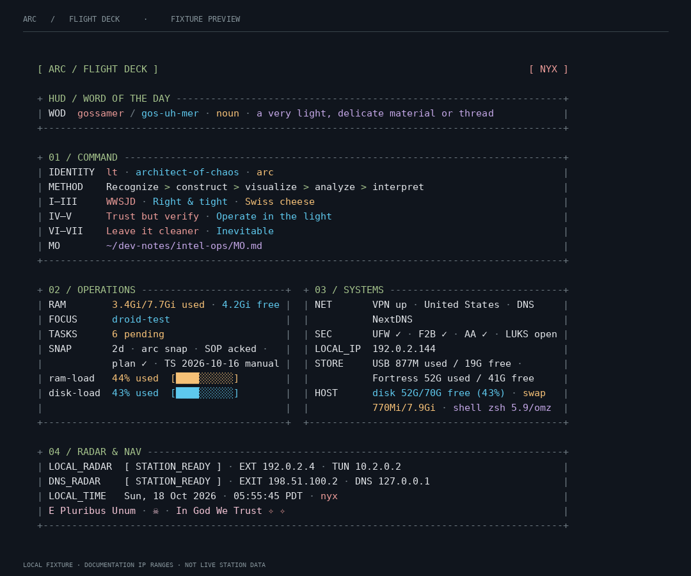

# Terminal cockpit

The terminal greeting now has a restrained cockpit layout: a HUD word strip, a full-width COMMAND display, paired OPERATIONS and SYSTEMS panes at the full 96-column reading width, and a full-width RADAR & NAV display below. Narrower panes stack for readability. Labels use the shortest consistent column needed by each section (capped at eleven cells), which gives long values more room. Paired panes keep one clean shared baseline; a muted spacer is used only if wrapping makes their heights differ.

The established color roles stay stable: sage for the cockpit identity and panel titles, slate for framing and separators, rose quartz for the motto, and distinct colors for status values. The active Circadian phase appears where it communicates live state: in the phase badge, the phase word beside `LOCAL_TIME`, and the two tiny motto glints. It does not recolor every frame, heading, or gauge. The WOD and numbered principles keep their four phase colors as content cues. `ram-load` stays amber and `disk-load` stays cyan; both state “% used” before a ten-cell meter and derive only from the displayed RAM ratio and disk percentage. Unknown input produces no derived gauge. Text wraps without clipping, including wide Unicode and combining characters. ASCII/plain output uses an ASCII meter and emits no ANSI styling.

The renderer is one embedded Python function in the same greeting object. The existing collector emits plain value records; rendering adds color and layout afterward. There is no new external helper, runtime dependency package, background process, timer, font install or service action.

The preview uses documentation-range IP addresses and fixed sample values. It is a visual fixture, not a live station health report.

## Verification and release state

The renderer remains embedded in the greeting object. It adds no external helper, runtime package, background process, timer, font install, or service action. Bash and zsh remain supported; no live operational probe is part of the visual fixture.

Activated locally on 18 October 2026: source and installed ~/.config/arc/greeting.sh match. New terminal tabs load the cockpit. The 80 ms cold-start figure was review guidance, not an owner-set release gate. No Git push or cloud rollout occurred.

Readability pass · 18 October 2026: paired panels use a near-even 49/51 split, giving SYSTEMS a small width bias. Section-sized labels and a trailing gutter preserve value space. Below the full 96-column measure the panes stack. The shared baseline stays aligned; any balancing row is muted and empty.

Circadian/readability refinement · 18 October 2026: restored the balanced fixed palette after the phase tint spread across the display. `[ KHAOS-LAB / 418 / DEV-STUDIO ]` uses steady sage with the numeric identifier in red; the phase badge, `LOCAL_TIME` phase word, and tiny glints track the current phase. Panel titles use steady sage and box rules use slate. The motto remains rose quartz. The WOD and principles keep their four phase colors. RAM and disk meters use stable amber and cyan with kebab-case labels and readable `43% used` before the ten-cell bar. The preview is a fixed Nyx-phase fixture with reserved example IPs, not live station data.

The refinement is installed at ~/.config/arc/greeting.sh with mode 0700; source and installed SHA-256 match. Rollback copy: ~/.config/arc/greeting.sh.before-circadian-gauges-20261018.

The pre-cockpit source candidate is backed up owner-only at ~/.config/arc/greeting.sh.candidate-before-cockpit-20261018. Restore that file to the repository config/greeting.sh to undo this source-only redesign. Existing installed-greeting rollback copies remain intact.

The immediate local rollback copy is ~/.config/arc/greeting.sh.before-cockpit-activation-20261018. No terminal reload or service restart was forced.
